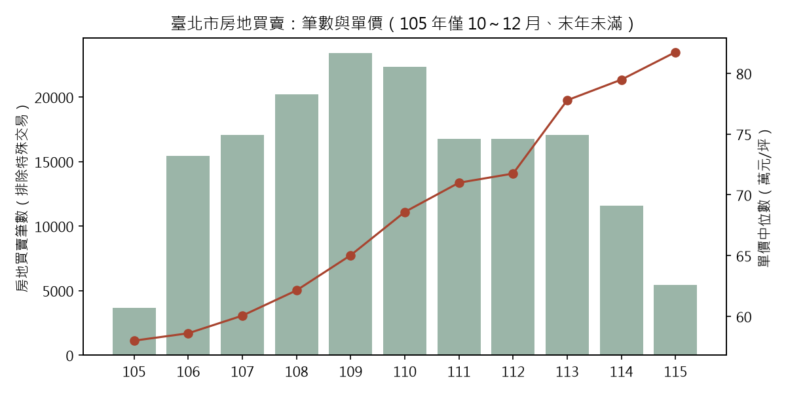
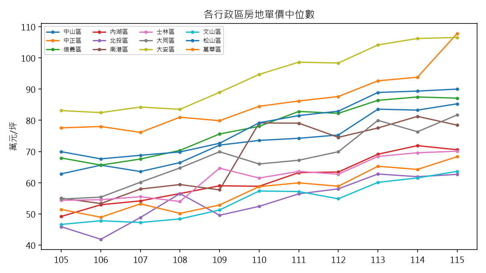
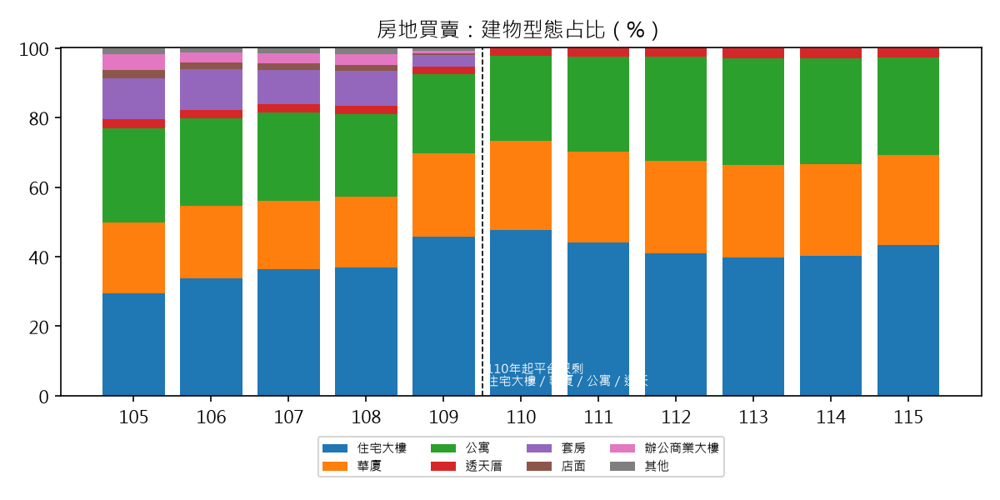
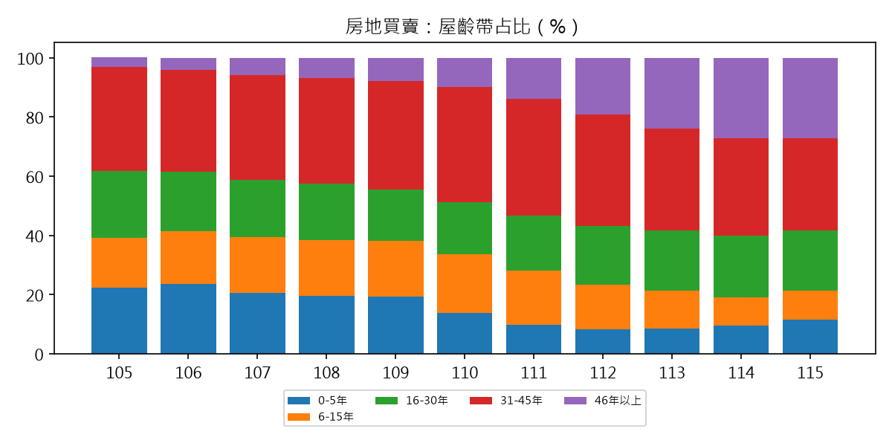
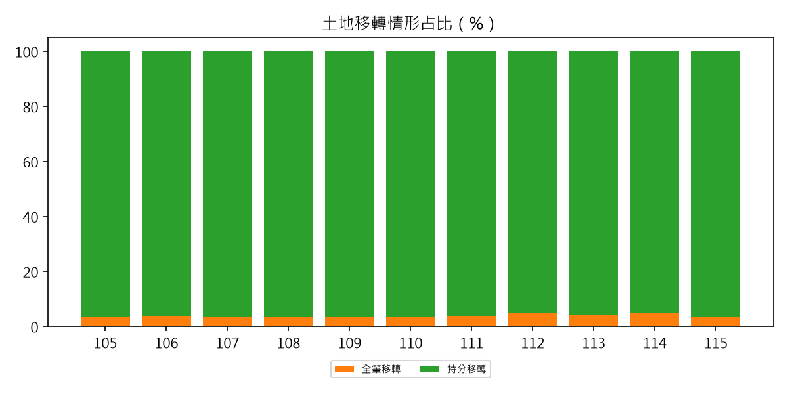

# 臺北市不動產買賣交易分析（民國 105 年 10 月～115 年 6 月）

資料來源：內政部不動產交易實價查詢服務網開放資料（季別下載包）。文中「表 1b」等編號對應附檔「分析表.xlsx」的分頁，圖檔為「圖1」至「圖5」。

## 摘要

1. **房地買賣單價逐年上升**：全市中位數由 106 年 58.6 萬元/坪升至 114 年 79.5 萬元/坪（+35.6%）；成交量 109 年達高峰後下滑，114 年僅 109 年的一半（房地買賣 25,890 → 13,937 筆）。
2. **土地利用以住宅區、商業區為主**：交易的土地筆數中住宅區 52.2%、商業區 26.8%、公共設施用地 14.0%，非都市土地近乎為零。公共設施用地占比由 106 年 14% 升至 114 年 22%，來源是道路用地的小筆持分交易。
3. **建物現況趨向老化**：房地買賣中屋齡 46 年以上者由 105 年 3% 升至 115 年 27%，5 年內新屋由 22% 降至 8～12%；公寓占比 110 年 24.5% → 113 年 30.7%。
4. **權屬幾乎都是持分移轉**：土地筆數中 96% 為持分移轉（房地交易 98～100%，純土地交易 82%），持分比 84% 低於 10%，反映區分所有的大樓與公寓；單筆交易涉及 1 筆土地者約 71～76%。

## 一、資料範圍與口徑

- 買賣（不含預售屋、租賃）231,248 筆，交易日 105/10～115/6。末端 115/7 以後登記未完整，已截掉；105 年只有 10～12 月、115 年只有 1～6 月。
- **單價統計排除**備註含親友、員工、特殊關係、債權債務、法拍、急買急賣、畸零地、地上權等「特殊交易」28,720 筆（12.4%），並排除單價在 2 萬～150 萬元/㎡ 以外者；房地單價有效筆數 169,694。
- 房地單價為平台單價（建物與土地合計、扣除車位），不可當地價。
- **「增建」備註未列為特殊交易**：105～108 年寫「增建或未登記建物」、109 年起寫「增建」，各年占 22～30%。表 1b 另列排除增建後的單價（約高 2～5%），行情趨勢方向不變。
- 107 年前的「主要用途」、109 年前的「電梯」欄位填寫不完整；**建物型態自 110 年起平台只剩住宅大樓、華廈、公寓、透天厝**，套房、店面、辦公商業大樓等併入或消失，故型態占比跨 109/110 不可直接比較（圖 3 虛線處）。

## 二、市場概況

| 年 | 房地買賣筆數（含車位） | 房地有效單價筆數 | 單價中位數（萬元/坪） | 總價中位數（萬元） | 建物面積中位數（坪） |
|---|---|---|---|---|---|
| 105（10–12月） | 4,320 | 3,671 | 58.0 | 1,802 | 33.0 |
| 106 | 17,613 | 15,432 | 58.6 | 1,766 | 33.2 |
| 107 | 19,389 | 17,071 | 60.1 | 1,810 | 32.8 |
| 108 | 22,654 | 20,180 | 62.1 | 1,906 | 33.8 |
| 109 | 25,890 | 23,423 | 65.0 | 2,000 | 33.3 |
| 110 | 24,742 | 22,349 | 68.6 | 2,110 | 33.2 |
| 111 | 19,266 | 16,742 | 71.0 | 2,088 | 31.6 |
| 112 | 19,398 | 16,739 | 71.7 | 2,041 | 30.6 |
| 113 | 20,027 | 17,043 | 77.8 | 2,200 | 30.6 |
| 114 | 13,937 | 11,599 | 79.5 | 2,275 | 30.6 |
| 115（1–6月） | 6,605 | 5,445 | 81.7 | 2,376 | 31.4 |

- 總價中位數升幅（106→114 約 +29%）小於單價（+36%），因為成交的建物面積中位數由 33 坪縮到 31 坪。
- **各區 106→114 單價中位數漲幅**：南港 +52%、北投 +48%（106 年樣本偏少，數字不穩）、大同 +38%、內湖 +36%、信義 +33%、松山 +32%、萬華 +31%、大安 +29%、文山 +29%、士林 +28%、中山 +27%、中正 +20%。全市 +36% 高於 12 區中的 8 區，全市中位數同時受成交結構變動影響，書件比較請用行政區或同型態。
- 114 年單價最高：大安 106.2 萬、中正 93.8 萬、松山 89.4 萬、信義 87.5 萬（元/坪）；最低：文山 61.5 萬、北投 61.9 萬、萬華 64.2 萬。

## 三、土地利用

土地明細以每筆交易所附地號計（一筆房地交易常附多筆土地，含道路用地持分）。

| 使用分區 | 土地筆數 | 占比 | 登載移轉面積（公頃） |
|---|---|---|---|
| 住宅區 | 184,504 | 52.2% | 474.2 |
| 商業區 | 94,902 | 26.8% | 106.6 |
| 公共設施用地 | 49,945 | 14.1% | 230.7 |
| 其他都市分區（特定專用區、遊樂區、聯合開發區、特定業務區、工商混合區等） | 11,974 | 3.4% | 50.6 |
| 工業區 | 6,659 | 1.9% | 56.7 |
| 保護區 | 3,586 | 1.0% | 170.8 |
| 農業區 | 1,085 | 0.3% | 60.7 |
| （使用分區未標示） | 885 | 0.3% | 1.7 |
| 非都市土地 | 17 | 0.0% | 0.1 |

- 住宅區以第三種為主（30.6%，另 23.2% 未分種），其次第三之一種、第三之二種、第二種；商業區以第三種（13.8%）與第四種（6.1%）為主（表 2g）。
- **公共設施用地占比上升**：106 年 13.6% → 112 年 17.2% → 114 年 22.5%（筆數 4,484 → 6,536）。純土地交易約 1.6 萬筆中，64% 的主要分區是公共設施用地，中位數 25.3 萬元/坪、面積 6.3 坪，是道路用地等零星持分（表 2e）。
- **純土地交易行情**（面積都很小，僅供參考）：住宅區 97 萬元/坪（中位面積 8.9 坪）、商業區 185 萬元/坪（5.8 坪）、工業區 100 萬元/坪（13.0 坪）、農業區 13.0 萬元/坪（141.1 坪）、保護區 10.3 萬元/坪（37.6 坪）。
- **房地單價依主要分區**：其他都市分區 85.3 萬（中位屋齡 15 年）、商業區 72.0 萬、住宅區 65.0 萬、保護區 50.7 萬、工業區 48.8 萬元/坪（表 2d）；保護區與農業區的房地交易只有 152、16 筆。
- 非都市土地僅 17 筆（特定專用區編定），臺北市的買賣交易幾乎都在都市計畫區內。

## 四、建物現況（房地買賣）

- **型態（110 年起可比）**：住宅大樓 40～48%、公寓 25～31%、華廈 26%、透天厝 2～3%。公寓占比 110 年 24.5% → 113 年 30.7%、114 年 30.3%、115 年 28.0%。
- **屋齡**：46 年以上 105 年 3.1% → 110 年 9.8% → 114 年 27.0%；0～5 年由 22% 降到 8～12%；31～45 年穩定在 31～40%（圖 4）。
- **屋齡與單價**：0～5 年 77.1 萬、6～15 年 71.2 萬、16～30 年 64.9 萬、31～45 年 58.9 萬元/坪；46 年以上回升到 66.9 萬，可能與區位（中正、大安、中山的老公寓與透天）有關，本分析未控制區位。
- **型態與單價**：透天厝 82.3 萬（中位屋齡 47 年）、住宅大樓 75.9 萬（15 年）、華廈 67.7 萬（25 年）、公寓 54.2 萬（43 年）。
- **總樓層**：5 層以下 28～36%、6～10 層 23～25%、11～15 層 29～35%、16 層以上 9～14%、26 層以上 1.5～3.8%。5 層以下占比 109 年 28.1% → 113 年 36.1%，與公寓占比上升一致。
- **住宅格局**：3 房 43～48%、2 房 21～26%、1 房 15～17%、4 房 12～15%、5 房以上約 2%，十年間幾乎不變。
- **主要用途**（107 年起）：住家用 82.0% → 78.2%，商業用 10.6% → 12.2%，辦公用約 3%，工業用 1.1% → 1.5%。
- **結構與管理**：鋼筋混凝土造 86.0%、加強磚造 4.8%、鋼骨鋼筋混凝土 3.7%、鋼骨 2.7%；有管理組織者 60% → 65%。
- 建物登記明細（同一交易可有多筆建物）中，主要用途為「共有部分」的有 292,097 筆、「住家用」133,640 筆。

## 五、權屬（移轉型態與持分）

開放資料**不含買賣雙方身分、法人或自然人、公私有地**，所以這裡的「權屬」是指移轉型態、持分與筆棟數。

- **移轉情形**：土地筆數中持分移轉 95～97%、全筆移轉 3～5%，各年穩定。依標的：房地 97.8%、房地加車位 99.8%、純土地 81.9% 為持分移轉（表 4h）。純土地交易中，公共設施用地 84.9%、工業區 86.7%、商業區 79.9%、住宅區 78.0% 為持分，保護區 67.5%、農業區 64.9% 較低（表 4i）。
- **持分比**（持分移轉的土地）：不到 1% 占 41.5%、1～10% 占 42.6%、10～50% 占 15.3%、50% 以上 0.5%（表 4c）。
- **單筆交易的土地筆數**：1 筆 71～76%、2 筆 16～19%、3～5 筆 7～9%、6～10 筆 0.9～1.4%、11 筆以上 0.2～0.9%。11 筆以上共約 1,000 筆，房地占 482 筆，總價中位數 1,770 萬元（表 4e、4f）。
- **備註所示特殊交易**：親友、員工或特殊關係間交易 109 年 9.3% → 110 年 9.1%，之後 111 年 12.4%、113 年 13.7%、115 年 15.8%，持續上升；含預售、換約、地上權、畸零地字樣的備註 109～110 年 13～14%，115 年 0.6%；債權債務與法拍自 109 年起趨近於零（表 4g）。

## 六、限制與後續

- 季別以登記日期分包，最新交易（115 年 7 月後）尚未登記完整；實價登錄資料會被更正或撤銷，114 年之後的數字日後可能小幅變動。
- 114 年成交量下滑（房地 13,937 筆，較 113 年 −30%）屬實際登記筆數，未判斷原因。
- 單價為中位數，未控制區位、屋齡、型態的混合效果；各區、各型態的比較請用表 1c、3e 對應的子集。
- 未納入預售屋與租賃（同一資料來源已有，可另行分析）；公有地、國有地需另以地籍資料或國有財產署資料處理。
