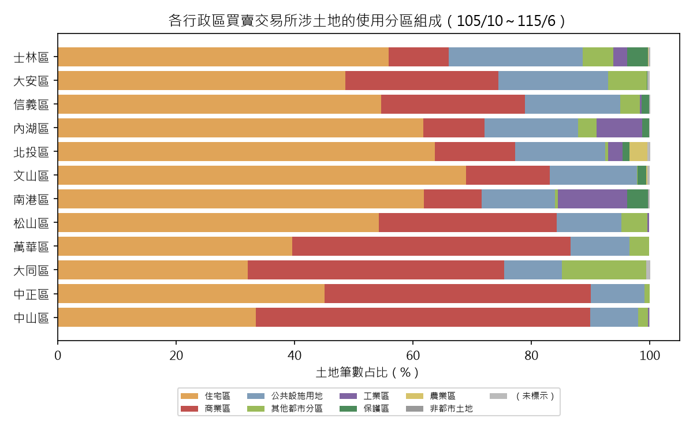
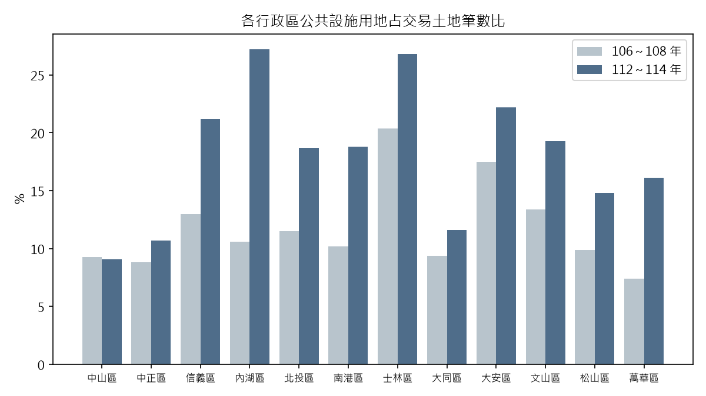

# 臺北市各行政區土地利用類型分析（民國 105 年 10 月～115 年 6 月買賣交易）

資料來源：內政部不動產交易實價查詢服務網開放資料。文中「表 A1」等編號對應附檔「行政區土地利用分析表.xlsx」的分頁；全市整體結果見「臺北市不動產買賣交易分析報告」。

## 摘要

1. **十二區可分三類**：商業區主導（中山、萬華、中正、大同）、住宅區主導（文山、北投、南港、內湖、士林），以及住商混合（大安、松山、信義）。
2. **工業區只集中在南港與內湖**：占交易土地筆數 11.7% 與 7.7%；其他各區都在 2.4% 以下。**農業區只有北投顯著**（965 筆、3.0%、56.9 公頃），**保護區以士林、南港最多**（各 3.5%）。
3. **十年間公共設施用地占比各區都上升（中山除外）**：內湖 10.6% → 27.2%（+16.5 個百分點）最多，其次萬華、南港、信義各約 +8～9 個百分點；中山不變（9.3% → 9.1%）。
4. **純土地交易的行情與面積差異極大**：大安、松山、信義的純土地交易 72～75% 是公共設施用地的小筆持分；士林的住宅區純土地交易中位面積 25.9 坪、單價只有 28 萬元/坪，大安則是 2.4 坪、185 萬元/坪。

## 一、各區使用分區組成

交易所涉土地筆數的占比（%）；筆數為每筆交易所附地號的列數（同一地號多次交易重複計）。

| 行政區 | 土地筆數 | 住宅區 | 商業區 | 公共設施用地 | 其他都市分區 | 工業區 | 保護區 | 農業區 |
|---|---|---|---|---|---|---|---|---|
| 中山區 | 41,663 | 33.5 | 56.4 | 8.1 | 1.7 | 0.2 | 0.0 | 0.0 |
| 中正區 | 23,157 | 45.1 | 44.9 | 9.1 | 0.9 | 0.0 | 0.0 | 0.0 |
| 信義區 | 28,779 | 54.6 | 24.3 | 16.1 | 3.3 | 0.3 | 1.3 | 0.0 |
| 內湖區 | 37,150 | 61.7 | 10.4 | 15.8 | 3.1 | 7.7 | 1.2 | 0.0 |
| 北投區 | 32,673 | 63.7 | 13.6 | 15.2 | 0.5 | 2.4 | 1.2 | 3.0 |
| 南港區 | 16,658 | 61.8 | 9.8 | 12.4 | 0.5 | 11.7 | 3.5 | 0.0 |
| 士林區 | 35,251 | 55.9 | 10.1 | 22.7 | 5.1 | 2.4 | 3.5 | 0.1 |
| 大同區 | 18,772 | 32.1 | 43.3 | 9.8 | 14.2 | 0.0 | 0.0 | 0.0 |
| 大安區 | 38,053 | 48.6 | 25.8 | 18.6 | 6.5 | 0.0 | 0.1 | 0.0 |
| 文山區 | 36,226 | 69.0 | 14.1 | 14.7 | 0.1 | 0.0 | 1.5 | 0.2 |
| 松山區 | 22,179 | 54.2 | 30.1 | 10.9 | 4.4 | 0.3 | 0.0 | 0.0 |
| 萬華區 | 22,996 | 39.6 | 47.0 | 10.0 | 3.3 | 0.0 | 0.0 | 0.0 |

各類的住商細分（表 A4，占各區住商筆數）：
- 中山：商業區第四種 22.8%、商業區（未分種）22.0%、商業區第三種 14.8%、住宅區第三種 16.7%。
- 萬華：商業區第四種 27.1%、商業區（未分種）19.1%、住宅區第三種 21.1%。
- 大同：商業區第三種 37.9%，另有住宅區第四種 14.9%（全市最高）。
- 住宅區第三種為主的區：南港 42.0%、士林 42.3%、內湖 41.4%、北投 41.4%。文山的住宅區第二種 16.5% 為各區最高。

## 二、各區特徵

- **商業區主導**：中山 56.4%、萬華 47.0%、中正 44.9%（中正住宅區與商業區各約一半）、大同 43.3%。大同的「其他都市分區」14.2% 也是各區最高（主要是特定專用區 2,016 筆與聯合開發區 619 筆）。
- **住宅區主導**：文山 69.0%、北投 63.7%、南港 61.8%、內湖 61.7%、士林 55.9%。
  - 內湖與南港有工業區（7.7%、11.7%）與工商、辦公類分區（內湖的工商混合區 447 筆、住商混合區 355 筆、辦公服務區 294 筆；南港的特定專用區 72 筆）。
  - 北投有 3.0% 的農業區與科技產業專用區（112 筆）；士林有 3.5% 保護區與遊樂區 1,238 筆、娛樂區 352 筆、產業服務區 160 筆。
- **住商混合**：信義（住 54.6%、商 24.3%，另有特定業務區 928 筆）、松山（住 54.2%、商 30.1%，敦化南北路特定專用區 693 筆）、大安（住 48.6%、商 25.8%，敦化南北路特定專用區 2,310 筆，公共設施用地 18.6%）。
- **登載面積（公頃，表 A3）**：內湖住宅區 63.5、公共設施用地 55.8、工業區 35.2、保護區 23.1；士林住宅區 79.7、保護區 71.3、公共設施用地 63.6；北投農業區 56.9、住宅區 67.7、公共設施用地 56.7；南港保護區 32.9。山邊各區的登載面積遠大於市中心各區，因為山坡地與大面積持分土地占比較高；面積僅供參考，持分移轉是否已乘持分，開放資料沒有說明。

## 三、十年間的變化

比較 106～108 年與 112～114 年（兩段都是完整年度）的占比（百分點，表 A5）：

| 行政區 | 住宅區 | 商業區 | 公共設施用地 |
|---|---|---|---|
| 中山 | 32.6 → 33.1（+0.4） | 55.6 → 56.3（+0.7） | 9.3 → 9.1（-0.2） |
| 中正 | 39.9 → 46.4（+6.6） | 50.6 → 41.6（-9.0） | 8.8 → 10.7（+1.9） |
| 信義 | 57.5 → 51.3（-6.2） | 23.7 → 22.7（-0.9） | 13.0 → 21.2（+8.2） |
| 內湖 | 66.6 → 52.8（-13.8） | 11.0 → 9.1（-1.9） | 10.6 → 27.2（+16.5） |
| 北投 | 66.3 → 61.8（-4.5） | 15.2 → 12.6（-2.5） | 11.5 → 18.7（+7.2） |
| 南港 | 62.7 → 56.4（-6.3） | 11.3 → 8.7（-2.6） | 10.2 → 18.8（+8.6） |
| 士林 | 58.1 → 51.7（-6.3） | 11.3 → 9.5（-1.8） | 20.4 → 26.8（+6.4） |
| 大同 | 33.2 → 33.2（-0.1） | 45.1 → 42.9（-2.2） | 9.4 → 11.6（+2.3） |
| 大安 | 49.0 → 44.6（-4.5） | 27.3 → 25.7（-1.6） | 17.5 → 22.2（+4.7） |
| 文山 | 71.8 → 66.0（-5.7） | 13.1 → 12.2（-0.8） | 13.4 → 19.3（+5.9） |
| 松山 | 53.3 → 52.8（-0.5） | 32.1 → 28.2（-3.9） | 9.9 → 14.8（+4.9） |
| 萬華 | 41.1 → 38.1（-3.0） | 48.9 → 42.5（-6.4） | 7.4 → 16.1（+8.7） |

- 公共設施用地占比升高是普遍現象（圖 A2），主要來自道路用地的小筆持分（見下一節純土地交易）；內湖升幅最大。這個占比反映「交易所附的地號組成」，不等於各區公共設施用地的實際面積。
- 中正的住宅區占比升高、商業區降低 9 個百分點，是商業區占比降幅最大的一區；萬華商業區降 6.4 個百分點。

## 四、純土地交易（交易標的為「土地」）

全市約 1.6 萬筆；以各筆交易土地筆數最多的分區為「主分區」。**單價排除特殊交易，且只列 20 筆以上的組合**。

- **公共設施用地占純土地交易的比例**：大安 74.8%、信義 72.9%、松山 71.5%、中山 66.9%、內湖 61.1%、萬華 54.4%、中正 49.4%、士林 48.4%、文山 48.0%、大同 44.3%、北投 42.5%、南港 39.0%。多以道路用地為主，中位數單價 15～36 萬元/坪、面積 3～14 坪。
- **住宅區純土地**（萬元/坪，中位面積）：松山 201.9（3.1 坪）、中正 192.8（8.2 坪）、大安 184.8（2.4 坪）、中山 150.0（4.0 坪）、信義 126.1（5.0 坪）、南港 115.0（8.0 坪）、大同 108.2（5.7 坪）、內湖 102.9（11.1 坪）、北投 89.9（11.8 坪）、萬華 84.0（7.1 坪）、文山 59.7（4.1 坪）、士林 28.0（25.9 坪）。
- **商業區純土地**：松山 257.6、內湖 256.1（29 筆）、大同 230.0、中山 215.0、文山 195.0、信義 193.6、大安 186.8、中正 165.0（中位面積僅 1.8 坪）、南港 162.0、萬華 153.6、北投 118.2、士林 84.2。
- **工業區純土地**：南港 119.5 萬元/坪（160 筆、8.4 坪）、內湖 103.0（269 筆、15.5 坪）、士林 72.7、北投 66.7、中山 51.2。
- **農業區與保護區**：北投農業區 525 筆，中位數 13.0 萬元/坪、中位面積 147.0 坪；文山農業區 20 筆、13.9 萬元/坪；士林保護區 76 筆、10.0 萬元/坪（37.6 坪）。
- 純土地交易面積多半很小，是零星持分或畸零土地的成交價，**不宜當成可開發土地的地價**。

## 五、房地交易的用地與用途

房地交易（含車位）依主分區的單價中位數（萬元/坪，只列 30 筆以上；排除特殊交易）：

| 行政區 | 住宅區 | 商業區 |
|---|---|---|
| 大安 | 91.3 | 98.6 |
| 中正 | 80.3 | 91.6 |
| 松山 | 76.5 | 79.0 |
| 中山 | 74.9 | 72.0 |
| 信義 | 72.8 | 87.4 |
| 南港 | 68.9 | 68.9 |
| 大同 | 64.9 | 69.1 |
| 士林 | 60.8 | 69.2 |
| 內湖 | 59.4 | 66.5 |
| 北投 | 52.9 | 59.5 |
| 文山 | 51.8 | 60.5 |
| 萬華 | 50.0 | 61.2 |

- 商業區的房地單價多數高於同區住宅區；中山相反（住宅區 74.9 高於商業區 72.0），南港相同（68.9）。萬華商業區 61.2 比住宅區 50.0 高 22%。
- 房地交易所在的主分區（107 年起，表 C3）：中山 63.3%、萬華 52.0%、大同 50.0% 在商業區；文山 79.3%、士林 79.3%、南港 77.1%、北投 76.5% 在住宅區。
- **建物主要用途**（房地交易，表 C2）：商業用占比中山 23.2%、大同 16.2%、松山 12.8%、中正 11.4%、大安 10.1%；工業用占比南港 6.4%、內湖 4.2%；辦公用中正 5.3%、萬華 4.9%、信義 4.4%；住家用最高的是文山 91.6%、士林 88.8%、北投 88.6%。

## 六、限制

- 土地筆數是交易附帶的地號，一筆房地買賣常附多筆土地（含道路用地持分），所以這裡的占比反映「成交的土地組成」，不是各區土地面積結構。
- 備註含增建者未列為特殊交易；特殊交易（親友、債權債務等）已從單價統計排除。
- 使用分區欄位的寫法不統一（簡稱「住」「商」、全稱、括號說明、公告日期等），程式歸為住宅區、商業區、工業區、公共設施用地、保護區、農業區、其他都市分區，另有 885 筆未標示分區。
- 本分析不含預售屋與租賃，也沒有控制屋齡、型態等差異。
