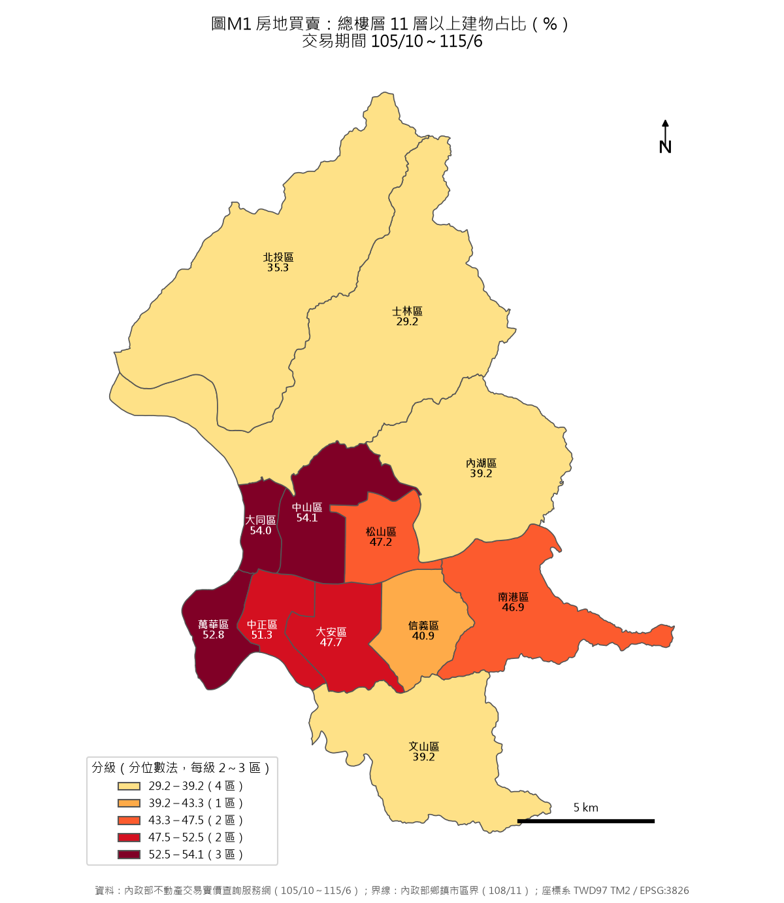
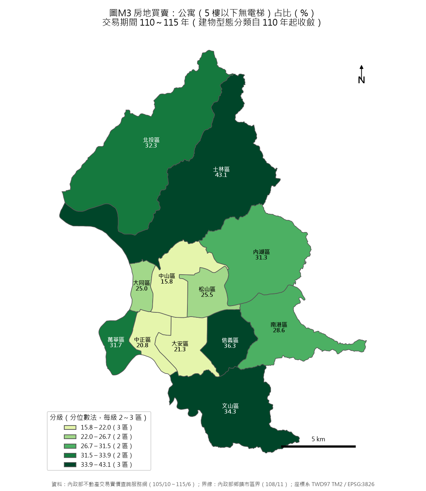
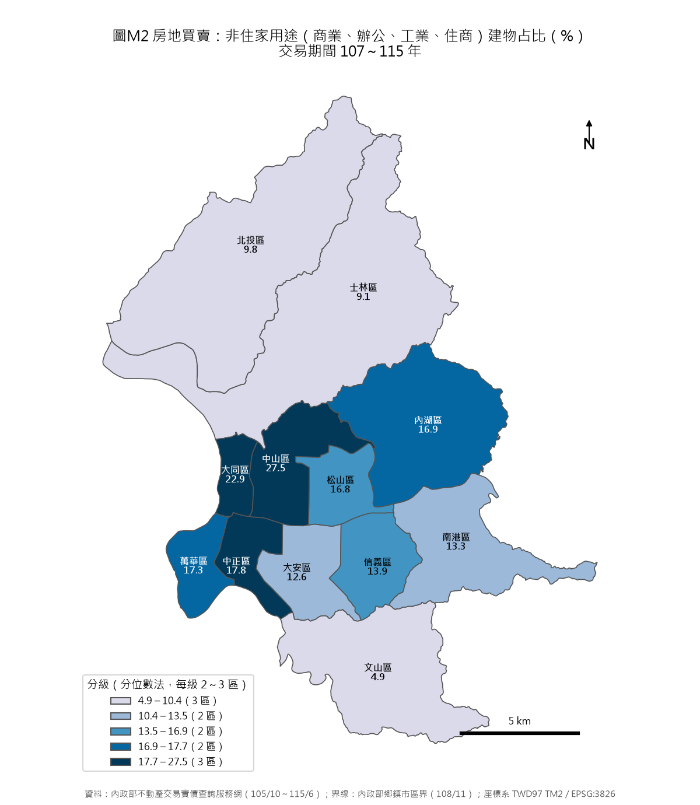

# 臺北市各行政區建物樓層、用途與型態分析（民國 105 年 10 月～115 年 6 月房地買賣）

資料來源：內政部不動產交易實價查詢服務網開放資料；行政區界線為內政部鄉鎮市區界（108 年 11 月版）。文中「表 E1」等編號對應附檔「行政區建物分析表.xlsx」的分頁；空間資料為 shp 資料夾內的「臺北市行政區_建物交易分析.shp」（欄位說明見「欄位說明.csv」）。

## 摘要

1. **樓層**：中山、大同、萬華、中正的房地交易有一半以上在 11 層以上的建物（51～54%），總樓層中位數 11 層；士林最低（29.2%，中位數 7 層）。十年間大多數區的高樓占比下降，萬華降最多（57.5% → 43.8%），只有松山略升。
2. **用途**：非住家用途（商業、辦公、工業、住商）占比以中山最高（27.5%），其次大同 22.9%；文山最低（4.9%）。工業用只在南港（6.3%）與內湖（4.3%）有明顯比例。
3. **型態**（110 年起）：中山、大同、中正、萬華以住宅大樓為主（49～53%）；士林、信義、文山的公寓占比最高（43.1%、36.3%、34.3%）。南港與文山的公寓占比 110～111 年到 114～115 年各增加約 11 個百分點。
4. 三張分層設色圖（圖 M1～M3）與 shp 已製作，shp 內另有樓層帶、型態、用途、屋齡、面積、單價等共 27 個屬性。

## 一、資料範圍與口徑

- 母體：房地買賣（交易標的含房地，含附車位者）共 193,841 筆；樓層、型態、用途、屋齡不排除特殊交易，單價排除特殊交易並排除單價在 2 萬～150 萬元/㎡ 以外者。
- **建物型態自 110 年起平台分類收斂**，只剩住宅大樓、華廈、公寓、透天厝，所以型態占比取 110 年起；**主要用途 106 年以前空白較多**，用途占比取 107 年起；樓層與屋齡全期間可用。
- 主要用途「未填」約占 3%（113 年起），各區略有差別，用途占比的十年變化會受影響，看變化時以商業用、辦公用、工業用等有填寫的項目為準。
- 「總樓層」是整棟建物的樓層數（國字數字已轉為數值），「交易所在樓層」是這筆交易所在的樓層；地下層與無法判讀者不計入。
- 105 年只有 10～12 月，單一行政區的樣本偏少，逐年表的 105 年數字不穩。

## 二、建物樓層

| 行政區 | 總樓層中位數 | 5 層以下 | 6～10 層 | 11～15 層 | 16～25 層 | 26 層以上 | 11 層以上 |
|---|---|---|---|---|---|---|---|
| 中山區 | 11 | 18.0 | 27.9 | 45.0 | 8.5 | 0.6 | 54.1 |
| 大同區 | 11 | 29.8 | 16.2 | 41.6 | 10.1 | 2.3 | 54.0 |
| 萬華區 | 11 | 34.5 | 12.6 | 36.2 | 12.0 | 4.6 | 52.8 |
| 中正區 | 11 | 23.4 | 25.2 | 40.9 | 9.2 | 1.2 | 51.3 |
| 大安區 | 9 | 22.1 | 30.2 | 34.2 | 11.2 | 2.3 | 47.7 |
| 松山區 | 9 | 28.5 | 24.3 | 33.5 | 13.7 | 0.0 | 47.2 |
| 南港區 | 10 | 31.7 | 21.3 | 27.5 | 13.9 | 5.5 | 46.9 |
| 信義區 | 7 | 39.0 | 20.1 | 27.8 | 11.1 | 2.0 | 40.9 |
| 內湖區 | 8 | 36.1 | 24.8 | 32.5 | 5.4 | 1.3 | 39.2 |
| 文山區 | 8 | 39.2 | 21.6 | 23.8 | 8.6 | 6.8 | 39.2 |
| 北投區 | 7 | 38.2 | 26.6 | 22.7 | 11.6 | 1.0 | 35.3 |
| 士林區 | 7 | 47.7 | 23.1 | 21.7 | 7.0 | 0.5 | 29.2 |

（占比 %，依 11 層以上由高到低排列）

- **26 層以上的高層建物**占比最高的是文山 6.8%、南港 5.5%、萬華 4.6%。
- **交易所在樓層**（表 E2）：1 樓交易占比士林 12.6%、信義 11.1%、文山 10.4% 較高，中山 6.5% 最低；11 樓以上以萬華 17.8%、大同 17.1%、南港 15.9% 最高，士林 8.7% 最低；整棟交易（透天、整棟）以大同 6.2%、萬華 5.1%、士林 4.4% 較多。
- **十年變化**（106～108 年 → 112～114 年的 11 層以上占比，表 E4）：萬華 57.5% → 43.8%（-13.7 個百分點）、內湖 -9.4、文山 -8.5、北投 -8.1、中正 -7.1、南港 -5.6、大同 -3.7、中山 -3.3、大安 -2.5、信義 -1.2、士林 -0.9，只有松山 +1.0。與公寓占比上升（下節）方向一致。

## 三、建物型態（110 年起）

| 行政區 | 住宅大樓 | 華廈 | 公寓 | 透天厝 |
|---|---|---|---|---|
| 中山區 | 52.8 | 30.2 | 15.8 | 1.3 |
| 大同區 | 51.9 | 16.4 | 25.0 | 6.7 |
| 中正區 | 50.0 | 26.8 | 20.8 | 2.5 |
| 萬華區 | 49.4 | 13.8 | 31.7 | 4.9 |
| 松山區 | 47.9 | 25.3 | 25.5 | 1.2 |
| 大安區 | 47.1 | 30.8 | 21.3 | 0.8 |
| 南港區 | 45.3 | 24.2 | 28.6 | 1.2 |
| 信義區 | 40.5 | 21.3 | 36.3 | 1.9 |
| 文山區 | 37.5 | 26.1 | 34.3 | 2.2 |
| 內湖區 | 35.4 | 30.8 | 31.3 | 2.5 |
| 北投區 | 32.9 | 31.3 | 32.3 | 3.5 |
| 士林區 | 27.4 | 25.0 | 43.1 | 4.5 |

（占比 %；南港另有「其他」0.7%）

- **公寓占比變化**（110～111 年 → 114～115 年，個百分點，表 F3）：南港 +11.3、文山 +11.0、萬華 +8.1、信義 +6.7、大同 +4.1、北投 +3.8、大安 +3.8、士林 +3.1、中正 +1.5、松山 +0.8、中山 +0.6、內湖 0.0。住宅大樓占比同期下降最多的是萬華 -12.5、文山 -9.3、南港 -8.4。
- **型態與單價**（萬元/坪，只列 30 筆以上；表 F4）：大安的住宅大樓 102.0、華廈 93.6、公寓 80.0 都是各區最高；公寓單價在萬華 43.4、文山 45.0、北投 44.2 最低。各區住宅大樓比公寓每坪貴 13～30 萬元，士林最大（30.4）、信義（27.8）、南港（24.8）次之，松山最小（13.2）。
- **屋齡**（中位屋齡）：公寓各區 38～47 年、華廈 14～37 年、住宅大樓 8～32 年，其中大安、松山的住宅大樓中位屋齡較高（32、26 年），南港、萬華、大同、北投僅 8～11 年。

## 四、建物主要用途（107 年起）

| 行政區 | 住家用 | 商業用 | 辦公用 | 工業用 | 住商用 | 非住家用途合計 |
|---|---|---|---|---|---|---|
| 中山區 | 69.8 | 23.4 | 2.9 | 0.0 | 1.2 | 27.5 |
| 大同區 | 69.9 | 16.2 | 4.1 | 0.9 | 1.7 | 22.9 |
| 中正區 | 75.1 | 11.2 | 5.7 | 0.1 | 0.8 | 17.8 |
| 萬華區 | 74.4 | 9.2 | 5.5 | 1.9 | 0.7 | 17.3 |
| 內湖區 | 81.0 | 9.7 | 2.3 | 4.3 | 0.6 | 16.9 |
| 松山區 | 79.2 | 12.8 | 3.2 | 0.1 | 0.7 | 16.8 |
| 信義區 | 81.6 | 8.2 | 4.9 | 0.2 | 0.6 | 13.9 |
| 南港區 | 84.0 | 3.9 | 2.7 | 6.3 | 0.4 | 13.3 |
| 大安區 | 81.3 | 10.0 | 2.0 | 0.0 | 0.6 | 12.6 |
| 北投區 | 88.9 | 5.9 | 3.0 | 0.3 | 0.6 | 9.8 |
| 士林區 | 88.7 | 6.4 | 1.3 | 0.6 | 0.8 | 9.1 |
| 文山區 | 92.9 | 4.0 | 0.5 | 0.0 | 0.4 | 4.9 |

（占比 %；另有「其他」與「未填」未列）

- 商業用以中山 23.4%、大同 16.2%、松山 12.8%、中正 11.2%、大安 10.0% 較高；辦公用以中正 5.7%、萬華 5.5%、信義 4.9% 較高。
- **十年變化**（107～109 年 → 113～115 年，表 G3）：商業用占比中正 9.5% → 14.0%、中山 21.7% → 25.8%、大同 14.7% → 18.5%、內湖 8.1% → 11.5% 增加；工業用南港 5.8% → 8.3%、內湖 4.0% → 5.9%；辦公用萬華 8.2% → 3.5%、中正 6.8% → 4.9% 下降。
- 非住家用途占比的逐年變化見表 G2：中山 27.8%（107 年）升到 31.6%（115 年）、南港 11.3% → 19.0%、內湖 18.4% → 21.3%（114～115 年），萬華 22.6%（107 年）降到 15～17%。

## 五、屋齡、面積與單價（補充）

| 行政區 | 屋齡中位數 | 屋齡 5 年內 % | 屋齡 46 年以上 % | 建物面積中位數（坪） | 房地單價中位數（萬元/坪，113～115 年） |
|---|---|---|---|---|---|
| 大安區 | 35 | 11.2 | 17.4 | 33.1 | 105.4 |
| 中正區 | 24 | 22.5 | 14.7 | 29.2 | 95.2 |
| 松山區 | 36 | 7.3 | 18.0 | 32.1 | 89.2 |
| 信義區 | 33 | 8.1 | 16.8 | 29.5 | 87.0 |
| 中山區 | 32 | 11.8 | 12.1 | 25.6 | 83.7 |
| 大同區 | 28 | 23.7 | 14.3 | 27.7 | 79.0 |
| 南港區 | 16 | 15.4 | 9.8 | 35.0 | 78.8 |
| 內湖區 | 23 | 15.8 | 2.0 | 36.1 | 70.2 |
| 士林區 | 37 | 11.3 | 20.3 | 34.6 | 69.1 |
| 萬華區 | 34 | 20.4 | 20.2 | 25.1 | 65.2 |
| 北投區 | 28 | 20.2 | 13.8 | 33.7 | 62.4 |
| 文山區 | 24 | 15.5 | 8.4 | 33.4 | 61.2 |

- 士林、萬華的 46 年以上老屋占比最高（約 20%），松山、大安約 17～18%；內湖僅 2.0%，南港中位屋齡 16 年最年輕。
- 士林的公寓占比最高（43.1%）、老屋占比最高（20.3%），房地單價在十二區中偏後（69.1 萬元/坪）；大安單價最高（105.4 萬元/坪），屋齡中位數 35 年也偏高。

## 六、地圖與空間資料

- 三張分層設色圖（圖 M1 樓層、圖 M2 用途、圖 M3 型態）以行政區為單位、分位數法分 5 級（每級 2～3 區），底圖為內政部鄉鎮市區界，座標系 TWD97 TM2（EPSG:3826）。
- shp/臺北市行政區_建物交易分析.shp：12 個行政區面，屬性欄位為英文代碼（長度限制），對照見 shp/欄位說明.csv；dbf 為 UTF-8，附 `.cpg`。可直接用 QGIS 以其他欄位做不同主題圖，例如樓層帶占比（`P_FL5`～`P_FL26UP`）、型態占比（`P_DALOU`、`P_HUACH`、`P_GONGY`、`P_TIAN`）、屋齡與單價。

## 七、限制

- 母體是實價登錄的成交案件，不是全部建物存量；成交結構（例如老公寓成交比例上升）會影響各占比。
- 行政區是最細的空間單位，區內差異（例如山邊與市區、不同生活圈）看不出來；若要更細，可用交易地號對上地籍圖，再以段小段或里分析。
- 本分析的樓層、型態、用途為登記或申報內容，未與建物登記資料逐筆核對。
